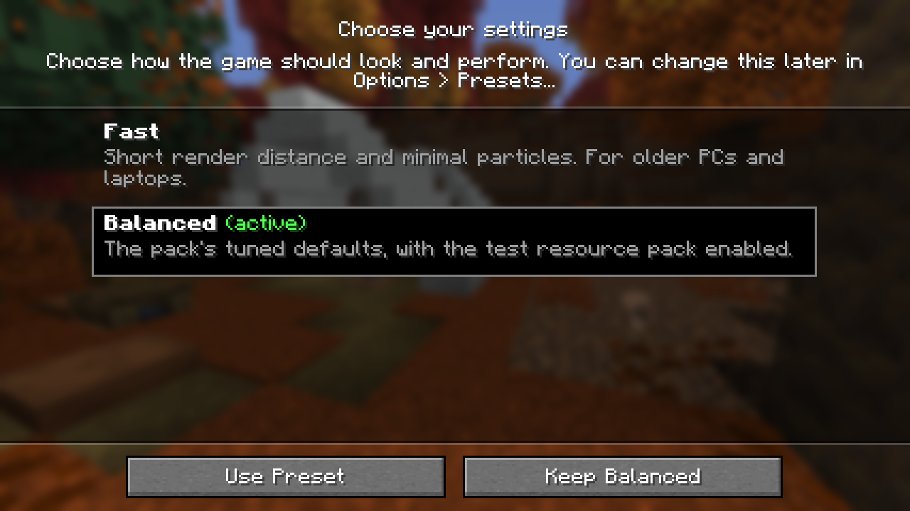
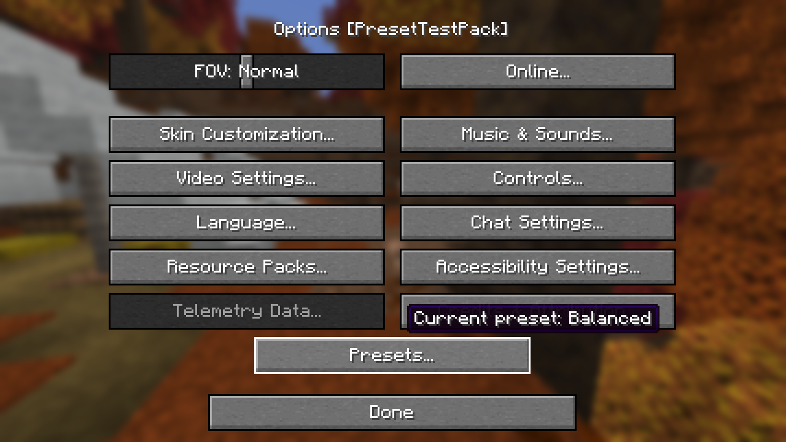

# Preset Switcher

A small, client-only Fabric mod that lets **modpacks** offer selectable settings presets such as *Potato*,
*Default* and *Beautiful*.

- On the **first launch** players pick a preset from a vanilla-style screen (names and descriptions come from the pack).
- Later they can switch from **Options > Presets...** or from the mod's config button in **Mod Menu**.
- The chosen preset is applied at the **next start**, before any other mod reads its config. The game says a restart
  is needed and offers to quit.
- A preset only sets the keys it declares. **Key binds, volumes, language and every other personal setting are
  kept** when switching.
- **Pack updates** never undo the player's choice: if the pack's preset definitions changed, the chosen preset's
  declared keys are applied again on the next start; otherwise live files are never touched.
- Everything is data-driven (`config/presetswitcher/presets.json5`); there is no pack-specific code.

Requirements: Minecraft 26.3, Fabric Loader 0.19.3 or newer, Java 25. Fabric API and Mod Menu are optional
(without Fabric API the UI is English only, because Fabric API loads mod language files).
The mod declares `"environment": "client"`: on a dedicated server installed from the same pack it is not loaded.





## For players

- First start: choose a preset, or keep the pack's default.
- Switch later: *Options > Presets...* (or Mod Menu > Preset Switcher > config). Choose *Quit Game* or restart later;
  the preset is applied when the game starts next time.
- Your choice is stored in `.presetswitcher/state.json` in the instance folder. Deleting that file makes the game
  apply the pack's default preset again and show the chooser on the next start.

## For pack authors

### Files

| Path | Owner | Purpose |
|---|---|---|
| `config/presetswitcher/presets.json5` | pack | Preset list and operations (JSON5: comments, trailing commas, unquoted keys allowed). |
| `config/presetswitcher/**` | pack | Any files the operations copy or merge from (e.g. one folder per preset). |
| `.presetswitcher/state.json` | player | Chosen / applied / pending preset, hash of the definitions. **Never ship this file.** |

Rules for a pack that uses presets:

1. **Do not ship files that presets manage as plain overrides.** A pack update would overwrite the player's live
   file with your copy while the player's chosen preset is not re-applied (the definitions didn't change). Ship
   them only inside `config/presetswitcher/` and let the presets write them. For first-launch defaults of files that
   are *not* preset-specific, use a `copy` with `when: "missing"` in `base` (this replaces YOSBR's job;
   don't ship the same file through YOSBR too).
2. Let every preset declare the **same set of keys**. A preset only writes what it declares, so a key that only
   *Beautiful* sets keeps Beautiful's value after switching to *Potato*. Put shared operations in `base` or in a
   preset that the others `extends`.
3. Any change inside `config/presetswitcher/` (definitions or source files) counts as a pack update and re-applies
   the chosen preset's declared keys on the next start. Keep the folder stable between releases unless you want
   that.
4. Never export `.presetswitcher/` with your instance.
5. **Minecraft 26.x options.txt:** vanilla re-applies `graphicsPreset` (`fast`, `fancy`, `fabulous`) at every start
   and overwrites render distance, simulation distance, particles, clouds, mipmaps, entity shadows and more. A
   preset that sets any of these must also set `graphicsPreset: "custom"`. The log warns when it doesn't.

### When presets are applied

| Situation at game start | What happens |
|---|---|
| No state file (first start of a new install) | `base` + default preset are applied. The chooser is shown once (after vanilla's onboarding screens). |
| The player chose another preset in game | `base` + that preset are applied. |
| Definitions folder changed since the last apply (pack update) | `base` + the chosen preset are applied again. |
| The chosen preset no longer exists | `base` + the default preset are applied; the chooser is shown again. |
| Nothing changed | Nothing is written. Steps that were *deferred* earlier (see `optional`/`createIfMissing`) are retried. |

The mod hooks Fabric Loader's language-adapter setup, which runs right after mod discovery: before mixin
configuration plugins (e.g. `sodium-mixins.properties`, `lithium.properties`) are read and before any `preLaunch`
entrypoint. Every config file a mod reads later sees the preset's values.

### presets.json5 reference

```json5
{
  formatVersion: 1,                     // optional; this mod reads version 1
  title: "Choose your settings",        // optional, chooser title (string or { en_us: "...", de_de: "..." })
  subtitle: "...",                      // optional, text under the title
  showChooserOnFirstLaunch: true,       // optional, default true (needs at least two presets)
  defaultPreset: "default",             // optional, default = first preset; applied on a new install
  base: [ /* operations run before every preset */ ],
  presets: [
    {
      id: "potato",                     // letters, digits, _ - . ; stored in the player's state
      name: "Potato",                   // string or { en_us: "...", de_de: "..." }
      description: "For weak PCs.",     // shown under the name (wrapped)
      extends: "default",               // optional, one id or a list; parents' operations run first
      operations: [ /* see below */ ],
    },
  ],
}
```

Every operation accepts `optional: true` (skip silently when its target is missing instead of retrying on the next
start) and `comment: "..."`. Unknown keys are rejected, so typos are reported. Paths are relative and `/`-separated;
`from` is relative to `config/presetswitcher/`, `file`/`to` to the game folder; `..` is not allowed.

#### `merge`: set keys in a config file

```json5
{ type: "merge", file: "options.txt", values: { graphicsPreset: "custom", renderDistance: 8, particles: 1 } }
{ type: "merge", file: "config/sodium-options.json", values: { "quality.weather_quality": "FAST", performance: { use_entity_culling: true } } }
{ type: "merge", file: "config/example.toml", values: { "general.enabled": false } }
{ type: "merge", file: "config/iris.properties", from: "potato/iris.properties" }     // every key of a partial file
{ type: "merge", file: "shaderpacks/MyShader*.zip.txt", format: "properties", values: { SHADOW_QUALITY: "1" } }  // every match
```

| Key | Meaning |
|---|---|
| `file` | Target file. May contain glob wildcards (`*`, `?`, `[ab]`, `{a,b}`) per path segment; every match is edited. |
| `format` | `options` (`key:value`, options.txt), `properties`, `json` (also JSON5), `toml`. Inferred from `options*.txt`, `.properties`, `.json`, `.json5`, `.toml`; required for other names. |
| `values` | Keys to set. For `json`/`toml`, dots separate path segments (`a.b.c`, `list.0` for an array element; `\\.` is a literal dot) and nested objects are flattened, so `{a: {b: 1}}` sets only `a.b`. Arrays are set as a whole. For `options`/`properties`, keys are literal (key binds contain dots). |
| `from` | A file in the definitions folder in the same format; all of its leaf keys are merged (values in `values` win). |
| `createIfMissing` | Default `true`: a missing target is created with just these keys (options.txt gets the current `version:` line so vanilla doesn't run its data fixers). `false`: the step is deferred and retried at each start until the file exists (e.g. a config a mod writes on its first run). |

What is preserved: `options` and `properties` files keep all other lines, comments and order; `toml` keeps comments
and layout (values in `[[array tables]]` cannot be addressed); `json` keeps key order and the indent unit but drops
comments (the file is rewritten as standard JSON, which is valid JSON5).

Value types: strings, numbers, booleans, arrays and objects. In `options.txt`, a string is written as-is, unless
the existing value in the file is quoted (vanilla stores enum options such as `graphicsPreset:"fancy"` as JSON
strings), then it is quoted too. Arrays and objects are written as compact JSON.

Value directive `$firstMatch` (for files whose names contain versions, e.g. shader packs):

```json5
{ type: "merge", file: "config/iris.properties", values: {
    enableShaders: true,
    shaderPack: { $firstMatch: "shaderpacks/ComplementaryUnbound*", fallback: "ComplementaryUnbound_r5.6.zip" },
} }
```

It resolves to the file name of the first match (sorted by name), with an optional `prefix`. Without a match and
without `fallback`, the step is deferred and retried at the next start.

#### `copy`: copy a file or folder

```json5
{ type: "copy", from: "base/options.txt", to: "options.txt", when: "missing" }   // first-launch defaults
{ type: "copy", from: "beautiful/config/voxy", to: "config/voxy", when: "always" }
```

`when`: `always` (default; overwrites the whole file, so the player's own edits of that file are lost on switch) or
`missing` (only if the target doesn't exist). Folders are copied file by file; other files in the target folder stay.

#### `resourcePacks`: change the enabled resource packs (options.txt)

```json5
{ type: "resourcePacks", disable: ["file/Heavy Pack.zip"] }
{ type: "resourcePacks", enable: ["file/Fresh Animations.zip", { $firstMatch: "resourcepacks/Better Clouds*", prefix: "file/" }] }
{ type: "resourcePacks", set: ["vanilla", "fabric", "file/Pack A.zip"] }
```

`set` replaces the whole list; otherwise `disable` removes and `enable` appends (on top, i.e. highest priority) packs,
keeping the ones the player added. `file/` prefixes are optional when comparing. Packs that are incompatible with
the game version are dropped by vanilla.

### Complete example

`config/presetswitcher/presets.json5`:

```json5
{
  formatVersion: 1,
  title: "Choose your settings",
  defaultPreset: "default",

  base: [
    // First-launch defaults for everything that is not preset-specific (replaces YOSBR's options.txt).
    { type: "copy", from: "base/options.txt", to: "options.txt", when: "missing" },
  ],

  presets: [
    {
      id: "potato",
      name: "Potato",
      description: "Lowest settings for weak PCs and laptops. No shaders, fewer particles.",
      operations: [
        { type: "merge", file: "options.txt", values: {
            graphicsPreset: "custom", renderDistance: 6, simulationDistance: 5, particles: 2, renderClouds: "false",
        } },
        { type: "merge", file: "config/sodium-options.json", from: "potato/sodium-options.json" },
        { type: "merge", file: "config/iris.properties", values: { enableShaders: false } },
        { type: "resourcePacks", disable: ["file/Fresh Animations.zip"] },
      ],
    },
    {
      id: "default",
      name: "Default",
      description: "The pack's tuned settings.",
      operations: [
        { type: "merge", file: "options.txt", values: {
            graphicsPreset: "custom", renderDistance: 12, simulationDistance: 8, particles: 0, renderClouds: "true",
        } },
        { type: "merge", file: "config/sodium-options.json", from: "default/sodium-options.json" },
        { type: "merge", file: "config/iris.properties", values: { enableShaders: false } },
        { type: "resourcePacks", enable: ["file/Fresh Animations.zip"] },
      ],
    },
    {
      id: "beautiful",
      name: "Beautiful",
      extends: "default",
      description: "Everything maxed, shaders on. Needs a strong GPU.",
      operations: [
        { type: "merge", file: "options.txt", values: { renderDistance: 24, simulationDistance: 12 } },
        { type: "merge", file: "config/iris.properties", values: {
            enableShaders: true,
            shaderPack: { $firstMatch: "shaderpacks/ComplementaryReimagined*", fallback: "ComplementaryReimagined_r5.6.zip" },
        } },
      ],
    },
  ],
}
```

with `config/presetswitcher/potato/sodium-options.json` containing only the keys that preset sets, e.g.

```json
{ "quality": { "weather_quality": "FAST", "leaves_quality": "FAST" }, "performance": { "use_entity_culling": true } }
```

### Disabling mods per preset (not supported)

Disabling heavy mods (renaming jars) is deliberately not offered:

- Fabric Loader discovers mods before any mod code runs, so a jar can only be disabled for the *next* start, by
  renaming it while the game runs. On Windows, jars that the running game has open cannot be renamed or deleted.
- Launchers re-install missing jars on pack updates (the jar is listed in `modrinth.index.json`), and a left-over
  `.jar.disabled` file is not tracked by the pack, so the result differs between launchers.

Use the mods' own config switches (e.g. Voxy/Iris enable flags) in presets instead.

## Building

```
./gradlew build      # JDK 25; jar in build/libs, unit tests for all formats and the start-up rules
```

## Example folder

[`example/config/presetswitcher/`](example/config/presetswitcher) is the two-preset definition used to test the mod
(options.txt keys, a JSON config, a .properties file from preset folders, a resource pack and first-launch defaults).

## License

MIT
